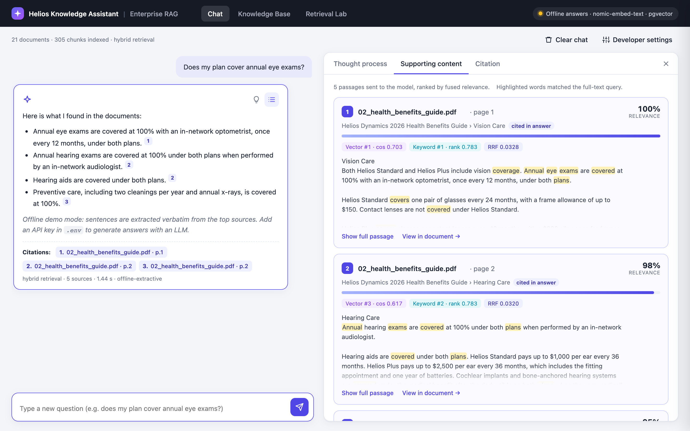
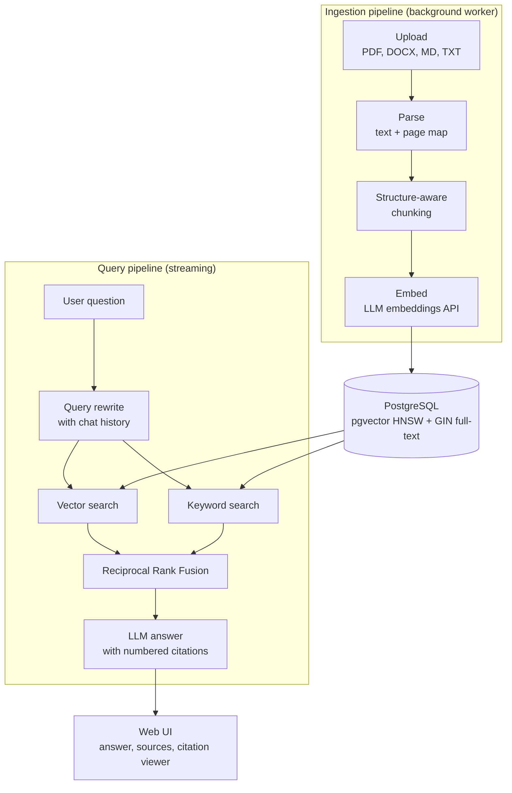
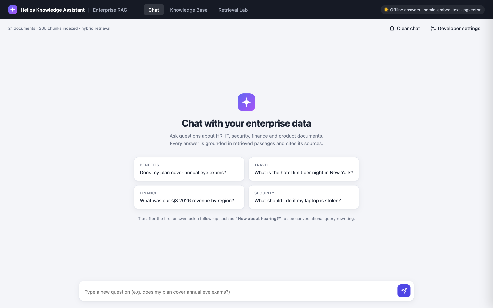
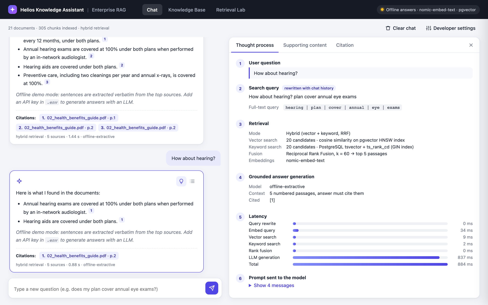
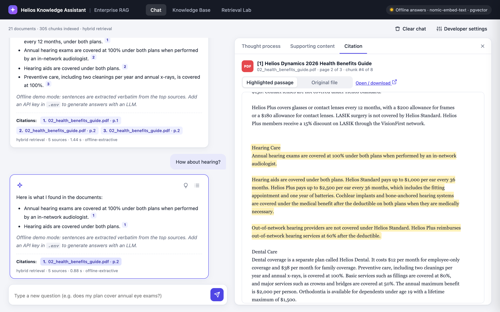
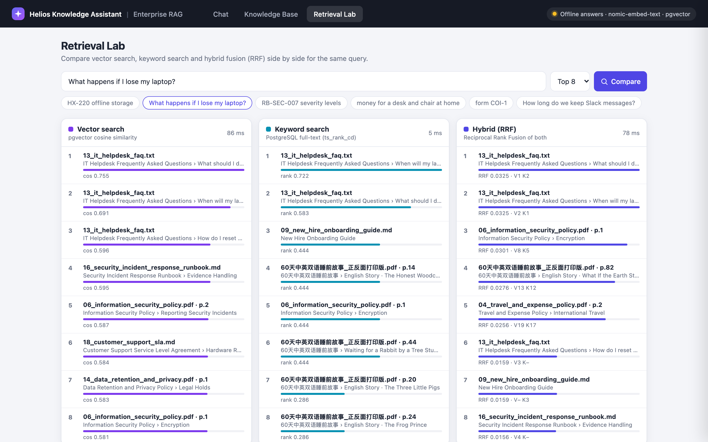
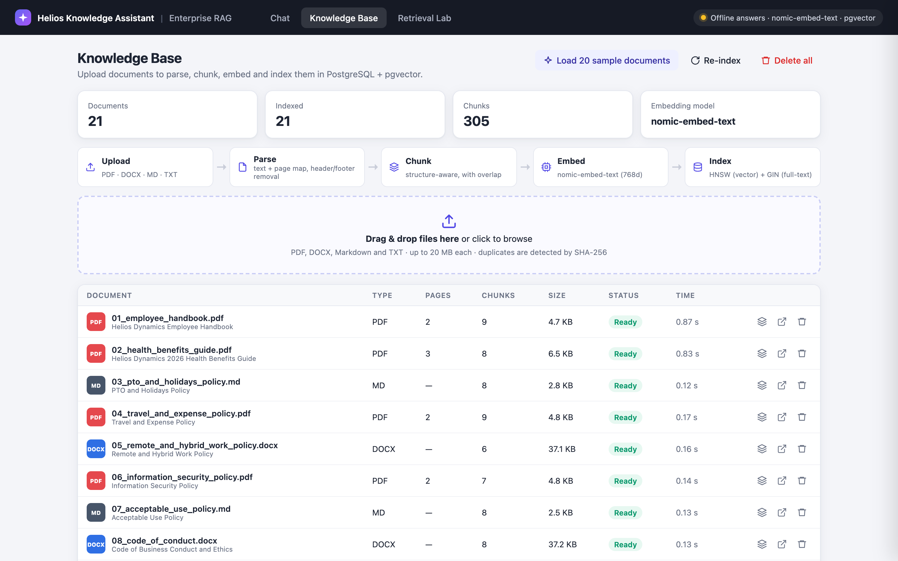
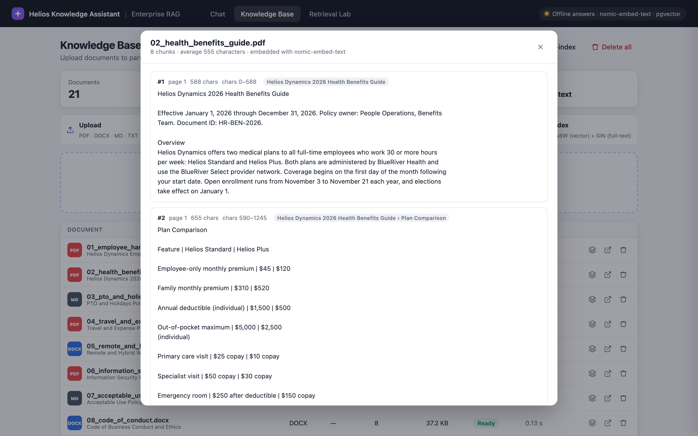

# Enterprise RAG: Chat with Your Company Documents

A production-style **Retrieval-Augmented Generation** system that lets employees ask questions about internal documents (HR policies, IT runbooks, financial reports, product catalogs) and get **grounded answers with clickable citations** to the original files.

**Stack:** Python · FastAPI · PostgreSQL + pgvector · OpenAI-compatible LLM API · vanilla JS frontend (no build step)



## What it demonstrates

| Capability | How it works |
|---|---|
| **Document ingestion** | Upload PDF, DOCX, Markdown and TXT (drag & drop, batch). Files are de-duplicated by SHA-256 and processed in a background worker with live status. |
| **Parsing** | Layout-aware PDF extraction keeps table rows intact, removes running headers/footers and tracks page numbers. DOCX headings, lists and tables are preserved. |
| **Chunking** | Structure-aware: splits on section headings and sentences (~900 chars, 150 overlap). Every chunk stores its section, page and character offsets. |
| **Embeddings** | `text-embedding-3-small` (1536-d) by default, or open-source `nomic-embed-text` (768-d) running locally in Ollama. Any OpenAI-compatible provider works, configured separately from the chat model. Chunks are embedded with their document title and section as context, and task prefixes are applied for models that expect them. |
| **Hybrid retrieval** | pgvector cosine similarity (HNSW index) **+** PostgreSQL full-text search (`tsvector`, GIN index), fused with **Reciprocal Rank Fusion**. |
| **Conversational search** | Follow-ups like *"How about hearing?"* are rewritten into standalone queries using the chat history. |
| **Grounded answers** | Streaming answers that must cite numbered sources `[1]`; citations open the source document with the exact passage highlighted. |
| **Transparency** | *Thought process* (query rewrite, retrieval stats, latency breakdown, full prompt) and *Supporting content* (vector, keyword and fused scores per passage). |
| **Retrieval Lab** | Side-by-side comparison of vector, keyword and hybrid results for any query. |
| **Evaluation** | `scripts/eval_retrieval.py` reports Hit@1, Hit@5 and MRR per retrieval mode on a golden question set. |

## Architecture



## Quick start (local, macOS)

**1. PostgreSQL + pgvector**

```bash
brew install postgresql@18 pgvector
brew services start postgresql@18
psql -d postgres -c "CREATE ROLE rag LOGIN PASSWORD 'rag' SUPERUSER;"
psql -d postgres -c "CREATE DATABASE rag OWNER rag;"
```

(Homebrew's `pgvector` ships for PostgreSQL 18+. On Linux, use your distro's `postgresql-XX-pgvector` package.)

**2. Python app**

```bash
python3 -m venv .venv
.venv/bin/pip install -r requirements.txt
cp .env.example .env          # add OPENAI_API_KEY (optional, see below)
.venv/bin/uvicorn app.main:app --port 8080
```

**3. Open http://localhost:8080**, go to **Knowledge Base**, and click **Load 20 sample documents** (or drag in your own files). The API docs are at http://localhost:8080/docs.

### Offline demo mode

Without any model configured the app still runs end to end. It uses a local feature-hashing embedder and an extractive answerer, so the whole pipeline can be shown without any API cost. Add `OPENAI_API_KEY` to switch to real embeddings and LLM answers, then click **Re-index**: the UI flags documents that were embedded with a different model.

### Local open-source embeddings (Ollama)

Embeddings can run locally and for free, independently of the chat model:

```bash
brew install ollama && ollama serve &
ollama pull nomic-embed-text
```

```dotenv
EMBEDDING_BASE_URL=http://localhost:11434/v1
EMBEDDING_MODEL=nomic-embed-text
EMBEDDING_DIM=768
```

The vector column size is fixed when the `chunks` table is created, so after changing `EMBEDDING_DIM` drop that table (`psql rag -c "DROP TABLE chunks;"`), restart the app and click **Re-index**.

### Other providers

Any OpenAI-compatible endpoint works. The chat model uses `OPENAI_BASE_URL`, `OPENAI_API_KEY` and `CHAT_MODEL`; embeddings use `EMBEDDING_BASE_URL`, `EMBEDDING_API_KEY`, `EMBEDDING_MODEL` and `EMBEDDING_DIM`, and fall back to the chat settings when unset. This covers Azure OpenAI (v1 API), DeepSeek, Groq, Together, Ollama and LM Studio.

### Docker (optional)

`docker compose up --build` starts PostgreSQL with pgvector and the API on http://localhost:8080.

## Demo script (about 3 minutes)

1. **Knowledge Base**: click *Load 20 sample documents* and watch the status move through parsing, chunking, embedding and ready. Open the chunk inspector on `02_health_benefits_guide.pdf` to show that the table rows and page numbers survived.
2. **Chat**: ask *"Does my plan cover annual eye exams?"*. Show the streamed answer, the citation chips and the *Supporting content* tab with the relevance bars and the vector, keyword and RRF scores.
3. Follow up with *"How about hearing?"*. Open *Thought process* to show that the question was rewritten using the chat history, plus the latency breakdown and the exact prompt.
4. Click a citation to open the **Citation** tab, where the source passage is highlighted inside the full document. Switch to *Original file* to show the PDF on the cited page.
5. **Retrieval Lab**: compare `RB-SEC-007 severity levels` (exact IDs, where keyword search wins) with `money for a desk and chair at home` (paraphrase, where vector search wins). Hybrid search is strong on both.
6. Optional: run `python scripts/eval_retrieval.py --url http://localhost:8080` to show measurable retrieval quality.

## Sample data

`sample_data/documents` contains 20 fictional documents for **Helios Dynamics**, an industrial IoT company: 8 PDF, 4 DOCX, 6 Markdown and 2 TXT. They cover health benefits, PTO, travel and expenses, remote work, information security, the code of conduct, the 401(k), parental leave, the IT FAQ, data retention, procurement, the incident runbook, the product catalog, the support SLA, a Q3 business review and the L&D program. Sources are in `sample_data/source`; regenerate them with `python scripts/generate_sample_docs.py`.

## API

| Method | Path | Purpose |
|---|---|---|
| `POST` | `/api/documents` | Upload one or more files (multipart) |
| `POST` | `/api/documents/sample` | Load the bundled sample documents |
| `GET` | `/api/documents` | List documents and their ingestion status |
| `GET` | `/api/documents/{id}/chunks` | Inspect how a document was chunked |
| `GET` | `/api/documents/{id}/file` | Original file (used by the citation viewer) |
| `POST` | `/api/documents/reindex` | Re-parse and re-embed everything |
| `POST` | `/api/search` | Retrieval only (`hybrid`, `vector` or `keyword`) with scores |
| `POST` | `/api/chat` | Streaming RAG answer (NDJSON events: `thought`, `sources`, `delta`, `done`) |
| `GET` | `/api/health` | Mode, models and index statistics |

## Project structure

```
app/
  main.py          FastAPI routes and static hosting
  ingest.py        upload validation, background ingestion pipeline
  parsing.py       PDF, DOCX, MD and TXT to text with a page map
  chunking.py      structure-aware chunker with offsets
  embeddings.py    OpenAI-compatible embedder and offline fallback
  retrieval.py     pgvector + full-text search with RRF fusion
  rag.py           query rewrite, grounded prompt, streaming answer
  llm.py           chat model client and offline extractive answerer
  schema.sql       tables, HNSW and GIN indexes
static/            single-page UI (chat, knowledge base, retrieval lab)
scripts/           sample data generator, retrieval eval, screenshot capture
sample_data/       20 demo documents and their markdown sources
```

## Screenshots

Captured with `nomic-embed-text` embeddings (Ollama, 768-d) and the offline extractive answerer; with a chat model configured, the answers are written by the LLM instead.

| | |
|---|---|
|  |  |
|  |  |
|  |  |

Regenerate them with `pip install playwright && python scripts/take_screenshots.py --url http://localhost:8080` (this uses your local Chrome).

## Production notes

Next steps for a real deployment: authentication and per-document access control (filter chunks by the user's groups in SQL), a cross-encoder reranker after fusion, OCR for scanned PDFs, a job queue such as Celery or RQ for ingestion at scale, and tracing of prompts and costs.
